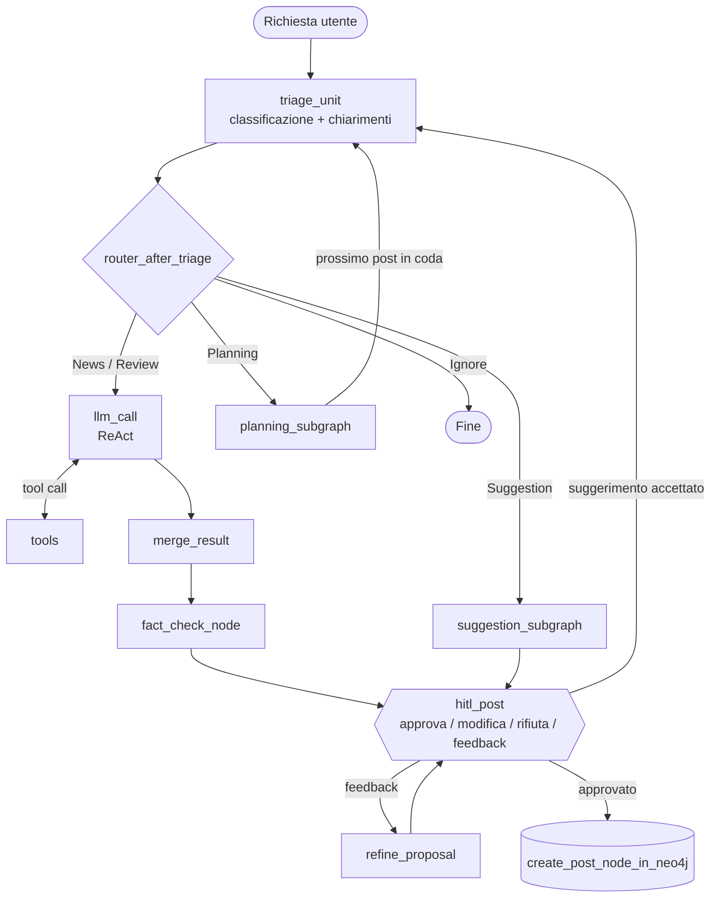

# Agentic AI for Video Game Blogging

Assistente editoriale **agentico** per un blog di videogiochi, costruito con **LangGraph**. Il sistema accompagna l'autore lungo tutto il ciclo di produzione dei contenuti: propone argomenti, pianifica il calendario editoriale, ricerca le informazioni (web, Steam, database locale) e scrive le bozze di **news** e **recensioni**. Ogni operazione importante passa da una **validazione umana** (Human-in-the-Loop) prima di essere salvata nel Knowledge Graph.

Progetto per il corso di **Cognitive Computing & Artificial Intelligence** (A.A. 2025/2026). I dettagli di progetto e le scelte implementative sono nella relazione [`Relazione/Relazione.pdf`](Relazione/Relazione.pdf).

---

## Funzionalità

| Funzione | Descrizione |
|---|---|
| **News** | Ricerca delle ultime notizie con Tavily, filtro delle fonti e stesura dell'articolo. |
| **Review** | Recensioni complete che uniscono dati dal web, dal database locale (RAG), recensioni degli utenti e prezzi da Steam. |
| **Suggestion** | Propone un nuovo articolo quando l'autore non sa cosa scrivere, analizzando lo storico dei post nel Knowledge Graph. |
| **Planning** | Piano editoriale per *n* giorni (1 post al giorno), salvato in coda su Neo4j e consumato un post alla volta. |
| **Fact checking** | Confronta la bozza con le fonti grezze e segnala dati inventati o non supportati. |
| **Rilevamento duplicati** | Prima di scrivere controlla su Neo4j se il gioco è già stato recensito o la news già pubblicata. |
| **Fine-tuning** | Classificatore di sentiment (*Positivo / Negativo / Misto*) per le recensioni degli utenti, addestrato su Kaggle. |

---

## Architettura



### Componenti principali

- **Orchestrazione:** [LangGraph](https://langchain-ai.github.io/langgraph/). Il grafo principale è in `workflow.py`; triage, suggerimento e pianificazione sono **sottografi** con stato indipendente, così la cronologia dei messaggi non si accumula e non confonde il modello.
- **Pattern di ragionamento:** **ReAct** (*Reasoning and Acting*): l'agente decide quale strumento usare, lo esegue e reagisce al risultato.
- **LLM:** servizio [Groq](https://groq.com/), con modelli diversi a seconda del compito (configurati in `State_template.py`).

  | Modello | Uso |
  |---|---|
  | `llama-3.3-70b-versatile` | Ragionamento ReAct, chiarimenti, brief, fact checking |
  | `llama-3.1-8b-instant` | Triage e rifinitura della bozza |
  | `openai/gpt-oss-120b` | Pianificazione editoriale e stesura finale (merge) |

- **Human-in-the-Loop:** il grafo si sospende con `interrupt` e l'autore può **approvare**, **modificare**, **rifiutare** o **rispondere con un feedback** a cui l'agente reagisce con una nuova versione.

### Sottografi

| Sottografo | Cartella | Ruolo |
|---|---|---|
| **Triage + chiarimento** | `Triage_router/` | Classifica la richiesta (`Review`, `News`, `Suggestion`, `Planning`, `Ignore`), pone eventuali domande all'utente, scrive il *research brief* e controlla i duplicati. |
| **Suggestion** | `Suggestion/` | Ragiona sullo storico dei post per proporre il prossimo articolo. |
| **Planning** | `Planning/` | Crea, mostra, elimina o avanza il piano editoriale (azioni `DO_RESEARCH`, `POP_NEXT`, `DELETE_EXISTING`, `INTERACTION`, `SHOW_MESSAGE`). |

---

## Strumenti (Tools)

| Tool | File | Descrizione |
|---|---|---|
| **Tavily Search (via MCP)** | `tools/tavily_search_tool.py`, `mcp_server/search_server.py` | Ricerca web in tempo reale esposta tramite **Model Context Protocol**. Il server MCP (`127.0.0.1:8765`) viene avviato in automatico come sottoprocesso. |
| **Steam** | `tools/steam_tool.py` | Risolve il nome del gioco in AppID e recupera recensioni degli utenti e prezzo. |
| **RAG** | `tools/RAG_tool.py` | Recupero semantico da **ChromaDB** (embedding `intfloat/multilingual-e5-base`) con soglia di pertinenza. |
| **Neo4j** | `tools/neo4j_tool.py` | Interroga il Knowledge Graph: controllo duplicati, giochi non ancora recensiti, contesto per la pianificazione, post esistenti su un gioco. |

---

## Knowledge Graph (Neo4j)

I post approvati vengono salvati dal nodo `create_post_node_in_neo4j` (`add_node.py`), che estrae con un LLM titolo, giochi, case editrici, generi e riassunto.

| Nodo | Descrizione |
|---|---|
| `Post` | Articolo pubblicato (news o recensione) con titolo, contenuto, data e overview |
| `Game` | Videogioco, anche solo menzionato (con flag `uscito`) |
| `Publisher` | Casa editrice / software house |
| `Genere` | Genere del gioco |
| `Source` | Dominio delle fonti usate |
| `Pianificazione` | Post in coda del piano editoriale (`stato: PENDING`) |

Relazioni principali: `(Post)-[:ABOUT]->(Game)`, `(Post)-[:MENTIONS]->(Game)`, `(Post)-[:PUBLISHED_BY]->(Publisher)`, `(Game)-[:HAS_GENERE]->(Genere)`, `(Post)-[:SOURCED_FROM]->(Source)`.

---

## RAG

I documenti di partenza sono in `RAG/recensioni.md`, un file Markdown con una sezione per gioco (trama, gameplay, analisi critica, ecc.). Lo script `RAG/crea_db_chroma.py` li divide per intestazione, li suddivide in *chunk* (400 parole, 50 di sovrapposizione, con il titolo di sezione anteposto) e li salva in ChromaDB nella cartella `chroma_db/`.

---

## Fine-tuning del classificatore di sentiment

Notebook: [`FineTuning/FineTuning.ipynb`](FineTuning/FineTuning.ipynb), da eseguire su **Kaggle**. Il task classifica una recensione in `negative`, `mixed` o `positive`, usando il dataset [`auphong2707/game-reviews-sentiment`](https://huggingface.co/datasets/auphong2707/game-reviews-sentiment) (recensioni sotto le 100 parole scartate, classi bilanciate: 8.400 esempi di train, 1.800 di validation e 1.800 di test).

Sono stati confrontati diversi approcci, con ricerca degli iperparametri e un *composite score* che penalizza l'overfitting:

| Modello | Tecnica | Accuracy | F1-macro |
|---|---|---|---|
| RoBERTa-large-MNLI | Zero-shot | 0,631 | 0,636 |
| **M1**: DistilBERT (Wenfi, IMDB) | **LoRA** | 0,732 | 0,730 |
| **M2**: DistilBERT | Full fine-tuning | 0,723 | 0,723 |
| BERT-base-uncased | Full fine-tuning | 0,745 | 0,746 |

Con LoRA si aggiornano circa 740 mila parametri (1,09% dei 67 milioni del full fine-tuning) e si ottengono risultati in linea con gli approcci più pesanti. Il notebook include anche uno stress test su esempi scritti a mano (sarcasmo, recensioni brevi, ecc.) e un'analisi **XAI** con *Integrated Gradients*.

> Il dataset è in inglese e la classe `mixed` resta la più difficile da riconoscere per tutti i modelli. Dettagli e limiti sono nel capitolo 9 della relazione.

---

## Struttura della repository

```
Agentic-AI-Videogames-Blogging/
├── workflow.py                  # Grafo principale (entry point di LangGraph)
├── State_template.py            # Stati, schemi Pydantic e configurazione degli LLM
├── langgraph.json               # Configurazione per `langgraph dev`
├── reasoner.py                  # Nodo ReAct (llm_call) e routing dei tool
├── route_after_triage.py        # Smistamento dopo il triage
├── merge_result.py              # Unione dei risultati dei tool e stesura della bozza
├── fact_checker.py              # Verifica della bozza rispetto alle fonti
├── hitl_post.py                 # Human-in-the-Loop e rifinitura della bozza
├── add_node.py                  # Salvataggio dei post in Neo4j
├── neo4j_connection.py          # Connessione al database
├── Triage_router/               # Sottografo di triage e chiarimento
├── Suggestion/                  # Sottografo dei suggerimenti editoriali
├── Planning/                    # Sottografo di pianificazione editoriale
├── tools/                       # Tavily, Steam, RAG, Neo4j
├── mcp_server/                  # Server MCP per la ricerca web
├── RAG/                         # Dati di partenza e script di creazione del DB vettoriale
├── prompts/                     # Prompt di sistema dei vari nodi
├── FineTuning/                  # Notebook di fine-tuning (Kaggle)
├── Relazione/                   # Relazione del progetto (PDF)
├── chroma_db/                   # Database vettoriale generato
└── requirements.txt
```

---

## Installazione

### Prerequisiti

- **Python 3.11** o superiore (versione configurata in `langgraph.json`)
- Chiavi API per [Groq](https://console.groq.com/), [Tavily](https://tavily.com/) e [LangSmith](https://smith.langchain.com/)
- Un database **Neo4j** in locale tramite [Neo4j Desktop](https://neo4j.com/download/) (in alternativa AuraDB)

### Dipendenze

```bash
pip install -r requirements.txt
```

### Variabili d'ambiente

Compilare il file `.env` nella root con le proprie chiavi:

```env
GROQ_API_KEY="<la_tua_chiave>"
TAVILY_API_KEY="<la_tua_chiave>"
LANGCHAIN_TRACING_V2="true"
LANGSMITH_API_KEY="<la_tua_chiave>"
LANGCHAIN_PROJECT="progetto cognitive"
NEO4J_URI=neo4j://127.0.0.1:7687
NEO4J_USERNAME=neo4j
NEO4J_PASSWORD="<password_del_db>"
NEO4J_DATABASE=<nome_db>
```

> ⚠️ Il file `.env` è escluso da `.gitignore`: non committare mai chiavi reali.

> **N.B.** Con il piano gratuito di Groq le richieste più pesanti, come la pianificazione, possono superare i limiti di token. Si consiglia il piano **Pay-As-You-Go**, che fa pagare solo l'utilizzo effettivo.

### Inizializzazione del database vettoriale

```bash
python RAG/crea_db_chroma.py
```

---

## Esecuzione

Con il database Neo4j attivo, dalla root del progetto:

```bash
langgraph dev
```

Il comando avvia il server locale di LangGraph e apre **LangSmith Studio**, da cui si interagisce con l'agente. Per gestire le interruzioni di Human-in-the-Loop (approva, modifica, rifiuta, feedback) va configurato anche **Agent Inbox**.

Esempi di richieste:

- *"Scrivi una recensione di Far Cry 3"* → ricerca, bozza, fact check, revisione umana e salvataggio nel grafo
- *"Ci sono novità su GTA VI?"* → news aggiornata con fonti
- *"Non so cosa scrivere, mi dai un'idea?"* → suggerimento basato sullo storico
- *"Crea un piano editoriale per 3 giorni"* → piano salvato in coda e primo post avviato

---

## Fine-tuning su Kaggle

Il fine-tuning richiede una GPU, perciò è stato svolto su [Kaggle](https://www.kaggle.com/):

1. **File** → **Import Notebook** e importare `FineTuning/FineTuning.ipynb`.
2. **Settings** → **Accelerator** e selezionare la GPU **T4 x2**.
3. Eseguire le celle.

---

## Autori

| Nome |
|---|
| Luca Camiolo |
| Gioele Messina |
